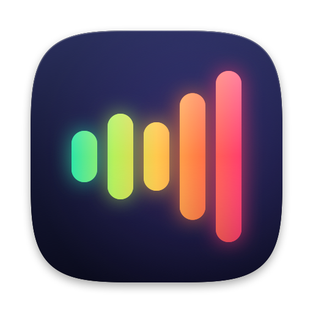

<p align="center">
  
</p>

<h1 align="center">Decibel</h1>

<p align="center">
  <b>Make your Mac louder and better-sounding, system-wide.</b><br>
  Volume boost, a 10-band EQ, per-app volume and media controls in your menu bar. No audio driver to install.
</p>

<p align="center">
  
  
  
  
</p>

<p align="center">
  <a href="#features">Features</a> ·
  <a href="#how-it-works">How it works</a> ·
  <a href="#build-and-run">Build and run</a> ·
  <a href="#troubleshooting">Troubleshooting</a>
</p>

---

Decibel sits in the menu bar and processes everything your Mac plays: boost it up to 800% without clipping, shape it with an EQ, and set every app's volume on its own. It uses Core Audio process taps (macOS 14.2+), so there is no kernel extension, virtual device or driver to install, and quitting it puts your audio back exactly as it was.

## Features

**Sound**
- Volume boost to 800% (+18 dB), with an always-on look-ahead brickwall limiter so it never clips (ceiling −1 dBFS).
- 10-band graphic EQ (32 Hz–16 kHz) with a live response curve, 16 built-in presets (Flat, Bass Boost, Vocal, Rock, Classical…), your own presets and reset to flat.
- Bass (100 Hz shelf) and treble (10 kHz shelf) tone controls.
- Balance and stereo width.

**Per-app mixer**
- A volume slider (0–200%) and mute for every app using audio, with its icon and a live activity meter.
- Helper processes are grouped under their app (Safari's WebKit GPU process, Chrome's audio service and so on).
- Settings are remembered per app and re-applied when the app plays again.

**Now Playing**
- Artwork, title, artist and source app for whatever is playing (Music, Spotify, a YouTube tab…), with previous, play/pause, next and a progress bar. Click the artwork to bring the app forward.

**System volume**
- Master output volume and mute, synced with the volume keys. The menu-bar icon shows the level.
- Software volume for outputs macOS can't control (most HDMI/DisplayPort displays).
- Microphone input level and mute.

**Devices**
- Every speaker, headphone, USB DAC, Bluetooth and AirPlay output and every input, with channel count and transport.
- One-click switching of the default output or input, and sample-rate selection where the device supports it (48 kHz suits most music and video; switching briefly interrupts sound).
- Follows connection, disconnection, default-device and sample-rate changes, plus sleep/wake.

## How it works

macOS 14.2 added Core Audio **process taps**, which let one app capture and mute other apps' output. Decibel:

```
apps you've adjusted ─▶ one tap per app ───┐
every other app ─────▶ one global tap ─────┤   (tapped apps are muted at the source)
                                           ▼
private aggregate device [ real output device + taps ]
                     │  one IOProc (C, real-time safe)
                     ▼
per-app gain + mix ─▶ EQ + tone ─▶ boost ─▶ width ─▶ balance ─▶ limiter ─▶ volume ─▶ real output device
```

- Decibel excludes itself from every tap. It also excludes processes that record the output device (eqMac's or Loopback's engine), which prevents feedback loops through virtual devices.
- An app gets its own tap the first time you change its volume. When it launches helpers or quits, the running taps' process lists are updated in place (`kAudioTapPropertyDescription`), so other audio never glitches.
- Quitting the app (or a crash) destroys the taps and apps play normally again.
- **Standby:** the taps only exist while something is playing *and* an effect is on (boost, EQ, tone, balance, width, a per-app volume or software volume). Otherwise Decibel releases them about 4 seconds later and watches each app's "running output" state, which needs no recording. Media in Now Playing is processed at once; other sound (alerts, a web page's sounds) must keep playing for 1.5 s first, and is released after 2 s of silence. macOS's purple recording indicator is therefore only shown while Decibel is actually processing sound, and short dings never trigger it.
- Now Playing uses Apple's private MediaRemote framework, which since macOS 15.4 only answers Apple-signed processes. Decibel loads a small helper (`NowPlayingHelper/`, embedded as `BSNowPlaying.framework`) into `/usr/bin/perl`, which streams state as JSON lines and accepts transport commands on stdin. If that ever stops working, the Now Playing card simply stays hidden.
- The DSP runs in plain C (`Packages/DecibelKit/Sources/BSKernel`), so the audio thread never allocates, locks or touches the Swift runtime. UI changes reach it through relaxed atomics and are smoothed (20 ms gains, 30 ms EQ) to avoid zipper noise.

**Privacy:** audio is processed in memory on your Mac and never written to disk or sent anywhere. Decibel makes no network requests.

## Requirements

- macOS 14.4 or later
- Xcode 16 or later (built with Xcode 27 / Swift 6.4)
- [XcodeGen](https://github.com/yonaskolb/XcodeGen) only if you change `project.yml`

## Build and run

```sh
git clone https://github.com/broisnischal/decibel.git && cd decibel
open Decibel.xcodeproj         # then ⌘R
# or from the command line:
xcodebuild -project Decibel.xcodeproj -scheme Decibel -derivedDataPath build/DerivedData build
open build/DerivedData/Build/Products/Debug/Decibel.app
```

On first launch macOS asks for **System Audio Recording** access. Decibel needs it to read app audio.

Signing uses the Apple Development identity for team `H8HKVKKHWL` (set in `project.yml`). Change `DEVELOPMENT_TEAM` there and run `xcodegen generate` to use another team. Keep a stable signing identity: macOS ties the permission grant to it.

### Upgrading from Forte

Decibel was called Forte (and BetterSound before that). Boost, EQ, presets and per-app volumes are imported automatically on first launch. The bundle ID changed to `io.github.broisnischal.decibel`, so macOS asks for System Audio Recording access again, and *Open at Login* needs to be switched back on. You can delete the old `Forte.app`.

## Tests

```sh
cd Packages/DecibelKit && swift test
```

The 16 tests cover:
- transparency at default settings, boost accuracy, and the limiter ceiling under +24 dB boost with heavy bass EQ on full-scale noise
- EQ band accuracy (±0.25 dB), the presets, the bass/treble shelves, EQ bypass, width and balance
- software output volume after the limiter, and recovery from NaN/Inf input
- the IOProc: per-app source mixing with gain and mute, click-free gain glides, activity and silence tracking, missing input, and channel mapping (interleaved, planar, mono, multichannel, tap after device inputs)

## Troubleshooting

| Symptom | Fix |
| --- | --- |
| Banner says permission is needed | System Settings › Privacy & Security › Screen & System Audio Recording, then enable Decibel under *System Audio Recording Only*. |
| Purple dot in the menu bar | That is macOS's system-audio-recording indicator. It shows only while Decibel is processing (sound playing and an effect on) and turns off about 4 s after playback stops, or after 2 s of silence when nothing is in Now Playing. Sounds shorter than 1.5 s outside Now Playing don't trigger it. |
| Reset the permission prompt | `tccutil reset AudioCapture io.github.broisnischal.decibel` |
| Signal-flow debugging | Launch with `--args -diagnostics YES`, then run `/usr/bin/log stream --predicate 'subsystem == "io.github.broisnischal.decibel"'`. It logs input/output levels each second and the app list (▶ playing, `[mixed]` has its own tap) every 5 s. |
| A mixed app's first sound leaks at 100% | A brand-new process plays through the shared tap until Decibel claims it (normally within a few ms). Long-running apps are unaffected. |

## Project layout

```
Decibel/                     SwiftUI menu-bar app (controller, views, assets)
Packages/DecibelKit/
  Sources/BSKernel/          C DSP kernel + HAL IOProc
  Sources/DecibelKit/        Core Audio plumbing: tap/aggregate router, devices and volume, app grouping, presets, permission
  Tests/                     Swift Testing suites for the DSP and IOProc
NowPlayingHelper/            MediaRemote bridge hosted by /usr/bin/perl
scripts/make-icon.swift      Renders the app icon set
project.yml                  XcodeGen spec for Decibel.xcodeproj
```

## The icon

Five capsules rising like a crescendo, coloured along a level meter's ramp from green to amber to red: sound getting louder, measured in decibels. It's drawn in code, so to change it, edit `scripts/make-icon.swift` and run:

```sh
swift scripts/make-icon.swift Decibel/Assets.xcassets/AppIcon.appiconset
```
